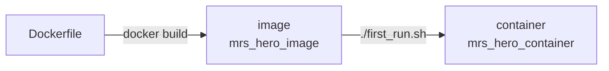

# Docker and tmux

In this tutorial you will learn the basics of Docker and tmux. Each section ends with a short hands-on exercise.

---
## Docker

At this level, you can think of Docker as a kind of virtual machine. That isn't exactly what it is, but it's close enough. It lets everyone work in the same system, with the same versions of ROS 2 and every library, no matter what's installed on their laptop. 

Two words you'll see a lot:
- **Image**: a recipe for the system, built once from the `Dockerfile`. Think of it as an installer.
- **Container**: a running copy of the image. This is where you work. Your changes in it stay until you delete it.



Common commands. Run them on your laptop, not in the container:
- `docker start -i mrs_hero_container` - starts the container and opens a terminal in it,
- `docker exec -it mrs_hero_container bash` - opens another terminal in the running container,
- `docker stop mrs_hero_container` - stops the container,
- `docker ps -a` - lists all containers and whether they're running,
- `docker rm mrs_hero_container` - deletes the container.

**NOTA BENE**
- Some folders in the container are folders on your laptop: `~/ros2_ws/src/hero_mrs` (the `mrs_docker_hero` folder) and, if you [bound one](own_package.md), your package at `~/ros2_ws/src/MY_PACKAGE_NAME`. Files there are safe even if you delete the container.
- Everything else in the container is deleted with `docker rm`.

### Hands-on #1

1. Do the three steps of the [installation](installation.md). Then start the container with `docker start -i mrs_hero_container`.
2. Look at the ROS 2 workspace:
    ```bash
    ls ~/ros2_ws/src
    ```
    You should see `hero_mrs`, `hero_sim`, `crazyswarm2` and, if you bound one, your own package, among others.
3. Start a ROS 2 node that publishes messages:
    ```bash
    ros2 run demo_nodes_py talker
    ```
4. On your laptop, open a second terminal in the same container and listen to the messages:
    ```bash
    docker exec -it mrs_hero_container bash
    ros2 run demo_nodes_py listener
    ```
5. Stop both nodes with `Ctrl+c`. In the second terminal, make a file:
    ```bash
    touch ~/hello.txt
    ```
6. Close both terminals with `exit`. Then start the container again and check that your file is still there:
    ```bash
    docker start -i mrs_hero_container
    ls ~
    ```

---
## tmux

You'll often need many terminals at once: the simulator in one, your code in another, and a third to check topics. tmux gives you many terminals in one window. The start scripts in this container also use it: they open a tmux session with every node in its own pane.

- A **session** is a group of windows. It keeps running when you close the terminal.
- A **window** is like a browser tab.
- A **pane** is a part of a window. A window can be split into several.

The keys in this container. `Ctrl+b, c` means: press `Ctrl+b`, let go, then press `c`.

| Keys | Does |
|---|---|
| `Ctrl` + arrows | move to the pane left, right, up or down |
| `Shift` + left/right | go to the previous/next window |
| `Ctrl+b, c` | new window |
| `Ctrl+b, %` | split the pane left and right |
| `Ctrl+b, "` | split the pane top and bottom |
| `Ctrl+b, [` | scroll through a pane's output (arrows or PgUp/PgDn, `q` to stop) |
| `Ctrl+b, d` | leave the session; it keeps running |
| `Ctrl+b, k` | **stop everything in the session** and close it |

Commands:
- `tmux new -s name` - starts a new session,
- `tmux ls` - lists the sessions,
- `tmux attach -t name` - goes back to a session you left,
- `tmux kill-session -t name` - stops a session.

### Hands-on #2

1. Start a session:
    ```bash
    tmux new -s practice
    ```
2. Split the window with `Ctrl+b, %`. Run `ros2 run demo_nodes_py talker` in the left pane. Move to the right pane with `Ctrl` + right arrow and run `ros2 run demo_nodes_py listener`.
3. Open a new window with `Ctrl+b, c` and run `ros2 topic list`. Go back to the first window with `Shift` + left arrow.
4. Leave the session with `Ctrl+b, d`. The nodes keep running: check with `tmux ls`. Go back with `tmux attach -t practice`.
5. Stop everything with `Ctrl+b, k`.

---
Next: [Simulation](tutorial_simulation.md).
