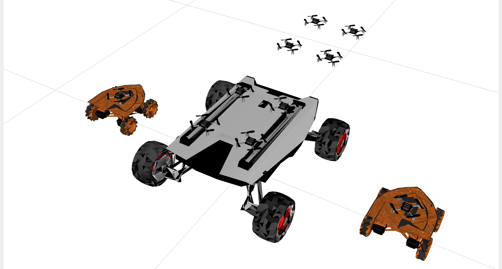

# Simulation: hero_sim

In this tutorial you will move robots in the hero_sim simulator and make your own scenario. Do the [Docker and tmux tutorial](tutorial_docker_tmux.md) first: the simulator runs in tmux.

Robots are expensive and slow to set up, so in robotics you test everything in simulation first. hero_sim shows Crazyflies and ground robots (herover, scout) in RViz. There's no physics: robots move exactly as commanded, so it starts in seconds.

You command the simulated robots through the same ROS 2 topics and services as the real ones. Code that works in hero_sim should work on the real robots with only small changes, like lower speeds.

<p align="center">
  
</p>

A **scenario** is a YAML file in `~/ros2_ws/src/hero_sim/config/`. It says which robots there are, where they start, and which map they drive in. In this course every map is an image of the floor, where black pixels are walls. Everything else is in the [hero_sim README](https://github.com/larics/hero_sim).

The main commands:

| Robot | Command | Topic or service |
|---|---|---|
| ground robot | drive with a velocity, in its own frame | topic `/<name>/cmd_vel` |
| ground robot | drive to a point (simulator only) | service `/<name>/go_to` |
| any | where it is | topic `/<name>/pose` |

## Hands-on

1. Start the MRS example scenario: six herovers on a maze map.
    ```bash
    cd ~/ros2_ws/src/hero_sim/startup
    bash start.sh mrs_world_example.yaml
    ```
    RViz opens, and you're in a tmux session called `hero_sim`.
2. Open a new tmux window (`Ctrl+b, c`) and drive `herover_3` forward, then stop it:
    ```bash
    ros2 topic pub --once /herover_3/cmd_vel geometry_msgs/msg/Twist "{linear: {x: 0.3}}"
    ros2 topic pub --once /herover_3/cmd_vel geometry_msgs/msg/Twist "{}"
    ```
3. Drive it with the keyboard (follow the keys it prints, `Ctrl+c` to stop):
    ```bash
    ros2 run teleop_twist_keyboard teleop_twist_keyboard --ros-args -r __ns:=/herover_3
    ```
4. Send `herover_6` to a point, turning it to a yaw of 1.57 rad (facing +y):
    ```bash
    ros2 service call /herover_6/go_to crazyflie_interfaces/srv/GoTo "{goal: {x: 2.0, y: -3.0}, yaw: 1.57, duration: {sec: 5}}"
    ```
5. Watch where `herover_6` is:
    ```bash
    ros2 topic echo /herover_6/pose
    ```
6. Stop the simulator with `Ctrl+b, k`.
7. Make your own scenario. Copy the example and open it:
    ```bash
    cd ~/ros2_ws/src/hero_sim/config
    cp mrs_world_example.yaml my_test.yaml
    nano my_test.yaml
    ```
    Move a robot, add a seventh one, or change `map:` to `hard_maze_10x10`. Then start it with `bash start.sh my_test.yaml` from the `startup` folder.

    This file is only in the container, and `docker rm` deletes it. To keep a scenario, put it in a folder from your laptop: see [Your own scenario](../README.md#your-own-scenario-robots-and-map).

---
Next: [Real robots](tutorial_robots.md).
